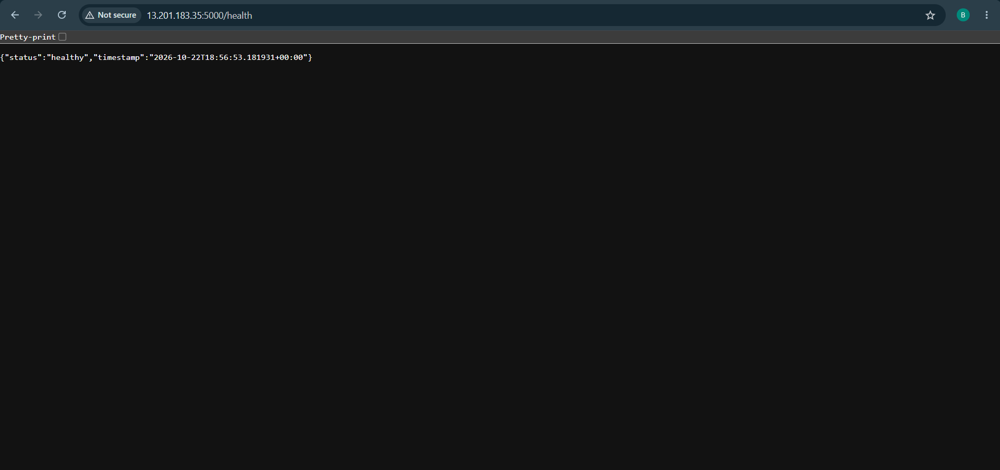

# End-to-End DevOps CI/CD Pipeline | AWS, Terraform & Monitoring

[](https://github.com/balaji0007-md/end-to-end-devops-pipeline/actions)


A hands-on DevOps engineering project that automates testing, container image publishing, and deployment of a Python Flask application. It combines a GitHub Actions CI/CD pipeline with Linux-based deployment, application and host monitoring, alerting, and reproducible AWS infrastructure provisioned using Terraform.

**Deployment environments:** GitHub Actions automates testing, image publishing, and deployment to an Ubuntu VM through a self-hosted runner. Separately, Terraform provisions AWS EC2 infrastructure and EC2 user data bootstraps the published Docker image. The AWS deployment was verified through HTTP health checks and AWS Systems Manager, then the lab resources were removed using Terraform.

## Architecture

```text
Developer / VS Code
        |
        v
  GitHub repository
        |
        v
    GitHub Actions (CI)
        |-- Python unit tests
        |-- Docker Buildx image build
        |-- Docker Hub push (latest + commit SHA on main)
        |
        v
 Self-hosted Ubuntu runner (CD on main)
        |
        v
 Restricted deployment script
        |
        v
 Flask container on local Ubuntu VM (:5000)
        |                       |
        |                       +--> /health, /metrics
        |                                  |
        |                              Prometheus <--- Node Exporter
        |                                  |
        |                               Grafana
        |                                  |
        |                           Gmail alerts
        |
        +----------------------------------------------+
                                                       |
 AWS deployment (Terraform-managed EC2 lab)        |
                                                       |
 Terraform --> VPC/subnet lookup --> security group    |
        |                                              |
        +--> EC2 (Ubuntu 24.04) + encrypted EBS         |
                 |                                     |
                 +--> IAM instance profile + SSM       |
                 +--> user data: install Docker        |
                 +--> Docker Hub image                 |
                 +--> Flask container (:5000) ---------+
                            |
                         /health
```

The GitHub Actions pipeline deploys to the Ubuntu VM, while Terraform and EC2 user data automate the AWS infrastructure and application bootstrap. Prometheus and Grafana monitor the Ubuntu VM deployment.

## Technology Stack

| Technology | Purpose |
| --- | --- |
| Python, Flask | Application and HTTP endpoints |
| Python `unittest` | Automated application tests |
| Git, GitHub | Source control and repository hosting |
| GitHub Actions | CI and local-VM continuous deployment |
| Self-hosted GitHub Actions runner | Runs local Ubuntu deployment job |
| Docker, Docker Hub | Containerization and image publishing |
| Linux, Bash, VMware | Local deployment environment and automation |
| Prometheus, Node Exporter | Application and host metrics |
| Grafana, Gmail SMTP | Dashboards, availability alerts and notifications |
| AWS EC2, IAM, Systems Manager | Cloud compute and secure remote administration |
| Terraform | Infrastructure as Code for AWS resources |
| AWS cloud-init / EC2 user data | Automated Docker installation and application startup |

## Application Endpoints

| Endpoint | Purpose |
| --- | --- |
| `/` | Application status |
| `/health` | Health-check endpoint |
| `/info` | Application and environment information |
| `/metrics` | Prometheus metrics |

## CI/CD: GitHub Actions to Ubuntu VM

The workflow is defined in [`.github/workflows/ci-cd.yml`](.github/workflows/ci-cd.yml).

1. Pushes and pull requests to `main` or `master` trigger the test-and-build job on a GitHub-hosted Ubuntu runner.
2. GitHub Actions installs Python dependencies and runs the application unit tests.
3. Docker Buildx builds the container image.
4. **On pushes to `main`**, the workflow publishes `balajimd07/balaji-flask-service` to Docker Hub with `latest` and commit-SHA tags.
5. After CI passes on `main`, the deployment job runs on a self-hosted Ubuntu runner labeled `flask-deploy`.
6. The runner invokes `/usr/local/sbin/deploy-flask` with the commit SHA to update the local Flask container.

**Image:** `balajimd07/balaji-flask-service`
**Local deployment container:** `balaji-flask-prod`
**Application port:** `5000`

The deployment script runs on the Ubuntu VM and updates the running Flask container using the commit-tagged image.

### Successful GitHub Actions Pipeline


### Run the Published Image

```bash
docker pull balajimd07/balaji-flask-service:latest
docker run -d --name balaji-flask-service -p 5000:5000 \
  balajimd07/balaji-flask-service:latest
curl http://localhost:5000/health
```

## AWS Infrastructure with Terraform

Terraform configuration is stored in [`terraform/`](terraform/).

### Infrastructure Provisioned

- **EC2:** Ubuntu Server 24.04 LTS on a configurable instance type (tested with `t3.micro`).
- **Networking:** Uses the default VPC and a subnet in the selected AWS region.
- **Security group:** Allows TCP port `5000` only from the configured trusted IPv4 CIDR; SSH ingress is disabled by default.
- **Storage:** Encrypted `gp3` root EBS volume (8 GiB by default).
- **IAM:** EC2 role and instance profile with `AmazonSSMManagedInstanceCore`.
- **Metadata:** IMDSv2 required for the instance.
- **Bootstrap:** EC2 user data installs Docker, enables its service, pulls the published image and starts the Flask container.
- **Operations:** AWS Systems Manager Session Manager provides administrative access without opening SSH port `22`.

### Terraform Files

| File | Purpose |
| --- | --- |
| [`main.tf`](terraform/main.tf) | VPC/subnet/AMI lookups, security group, EC2, IAM and instance profile |
| [`variables.tf`](terraform/variables.tf) | Configurable region, instance size, volume size, project name and access CIDRs |
| [`versions.tf`](terraform/versions.tf) | Terraform and AWS provider configuration |
| [`outputs.tf`](terraform/outputs.tf) | EC2 instance ID, public IP and Flask health-check URL |
| [`user-data.sh`](terraform/user-data.sh) | Automated host setup and Docker deployment |
| [`.terraform.lock.hcl`](terraform/.terraform.lock.hcl) | AWS provider dependency lock file |

### Deploy to AWS

**Prerequisites:** Terraform, AWS CLI, an authenticated AWS profile with appropriate permissions, and access to the selected AWS region. AWS resources may incur charges. This project uses the default VPC, which must exist in the chosen region.

1. Clone the repository and enter the Terraform directory:

   ```bash
   git clone https://github.com/balaji0007-md/end-to-end-devops-pipeline.git
   cd end-to-end-devops-pipeline/terraform
   ```

2. Create a local `terraform.tfvars` file (excluded from Git):

   ```hcl
   aws_region         = "ap-south-1"
   instance_type      = "t3.micro"
   root_volume_size   = 8
   allowed_ssh_cidr   = null
   allowed_flask_cidr = "YOUR_PUBLIC_IPV4/32"
   ```

   Replace `YOUR_PUBLIC_IPV4/32` with your own public IPv4 address in CIDR notation. Do not set `0.0.0.0/0` for a public lab unless access is deliberately intended and adequately protected.

3. Initialize, format, validate and review the infrastructure plan:

   ```bash
   terraform init
   terraform fmt -check
   terraform validate
   terraform plan -out=tfplan
   ```

4. After reviewing the plan, provision the resources:

   ```bash
   terraform apply tfplan
   terraform output
   ```

5. After EC2 user-data execution finishes, validate the application through the printed `flask_url`. The endpoint uses **HTTP, not HTTPS**, and is intended only for a restricted, short-lived lab.

6. When testing is complete, remove the temporary infrastructure:

   ```bash
   terraform plan -destroy
   terraform destroy
   terraform state list
   ```

   Review the destroy plan before confirming. `terraform state list` should be empty after a successful teardown. AWS billing information may take time to reflect resource removal.

### AWS Deployment Validation

The application was successfully deployed to EC2 and validated with:

- Successful cloud-init execution without errors.
- Active Docker service and a healthy running Flask container.
- HTTP `200 OK` from `/health` locally on the instance.
- HTTP `200 OK` from the browser-accessible EC2 health endpoint, restricted to the trusted client IP.
- An online EC2 managed node in AWS Systems Manager.
- Successful Terraform destruction of the seven resources created for the lab.



### Secure EC2 Access with Systems Manager

Once the instance has registered with Systems Manager, a session can be started using its ID:

```bash
aws ssm start-session --target INSTANCE_ID --region ap-south-1 --profile YOUR_AWS_PROFILE
```

Useful checks inside the Ubuntu instance:

```bash
cloud-init status --long
sudo systemctl is-active docker
sudo docker ps
sudo docker logs --tail 50 balaji-flask-prod
curl -i http://localhost:5000/health
```

### AWS Troubleshooting: EC2 User-data Execution

During initial deployment testing, cloud-init reported an `Exec format error` because the shell script had a blank line before the `#!/bin/bash` shebang. The script was corrected so the shebang was the first bytes of the file, saved with Unix line endings, and the EC2 instance was replaced using Terraform. The subsequent deployment completed successfully.

Useful diagnostic commands:

```bash
cloud-init status --long
sudo tail -100 /var/log/cloud-init-output.log
sudo head -1 /var/lib/cloud/instance/scripts/part-001 | od -An -tx1
```

This illustrates the importance of validating startup scripts and inspecting cloud-init logs when automated instance bootstrapping fails.

## Monitoring and Observability (Local Ubuntu VM)

The Ubuntu VM hosts a Docker Compose monitoring stack under `/opt/devops-monitoring/compose.yaml`. Prometheus scrapes metrics from the Flask container and Node Exporter, and Grafana provides dashboards and alerting for the Ubuntu deployment.

### Prometheus Targets

| Job | Target from Prometheus | Purpose |
| --- | --- | --- |
| `prometheus` | `localhost:9090` | Prometheus metrics |
| `ubuntu-server` | `node-exporter:9100` | Host CPU, memory, network and filesystem metrics |
| `flask-application` | `host.docker.internal:5000` | Flask application metrics |

All three targets were verified as **UP** in the local lab.


### Grafana Dashboards

Grafana runs on port `3000` of the Ubuntu VM. Configured dashboards include:

- **Node Exporter Full:** CPU, memory, disk and network metrics.
- **Flask Application Monitoring:** request rate, HTTP error rate, response time and service availability.

Example PromQL queries:

**Requests per second**

```promql
sum(rate(flask_http_request_total{job="flask-application"}[5m]))
```

**HTTP error percentage**

```promql
100 *
sum(rate(flask_http_request_total{job="flask-application",status=~"4..|5.."}[5m]))
/
clamp_min(sum(rate(flask_http_request_total{job="flask-application"}[5m])), 0.000001)
```

**Application availability**

```promql
up{job="flask-application"}
```


### Alerting and Incident Simulation

The **Flask Application Down** Grafana alert evaluates `up{job="flask-application"}` every minute and fires when availability remains below `1` for two minutes. Gmail SMTP sends downtime and recovery notifications.

The alert was validated through a controlled test: stopping the Flask container triggered a firing notification; restarting it restored the Prometheus target and generated a resolved notification.


## Run and Test Locally

```bash
git clone https://github.com/balaji0007-md/end-to-end-devops-pipeline.git
cd end-to-end-devops-pipeline
python -m pip install -r app/requirements.txt
python -m unittest discover -s tests -v
python app/app.py
```

Open `http://localhost:5000/` or query `http://localhost:5000/health`.

The automated tests cover the `/`, `/health`, and `/info` endpoints.

## Operational Troubleshooting

**Flask container and application logs**

```bash
sudo docker ps -a
sudo docker logs --tail 50 balaji-flask-prod
curl http://localhost:5000/health
```

**Monitoring containers (local VM)**

```bash
cd /opt/devops-monitoring
sudo docker compose ps
sudo docker logs --tail 50 devops-grafana
```

**Prometheus scrape health:** Open `http://<ubuntu-vm-ip>:9090/targets` from a machine with network access to the VM.
**CI/CD failures:** Inspect the relevant job and step in [GitHub Actions](https://github.com/balaji0007-md/end-to-end-devops-pipeline/actions).

## Security and Operations

- Docker Hub login uses GitHub Actions secrets; no registry credentials are stored in the workflow.
- The local deployment runner uses a dedicated Linux account and a restricted sudo-authorized deployment command.
- Application Docker images are tagged with a Git commit SHA for traceability.
- SMTP credentials remain in a server-local environment file, excluded from Git.
- Terraform state, saved plans, `.tfvars` files, `.env` files and provider cache directories are excluded via `.gitignore`.
- The AWS EC2 instance requires IMDSv2, uses an encrypted root volume, and supports Systems Manager access without inbound SSH.
- The AWS application endpoint used HTTP on port `5000` with access restricted to a trusted client IP for deployment validation.
- After successful testing, Terraform removed the temporary AWS resources. The deployment screenshot records the verified health-check response.

## Author

**balaji0007-md** · [GitHub](https://github.com/balaji0007-md)
