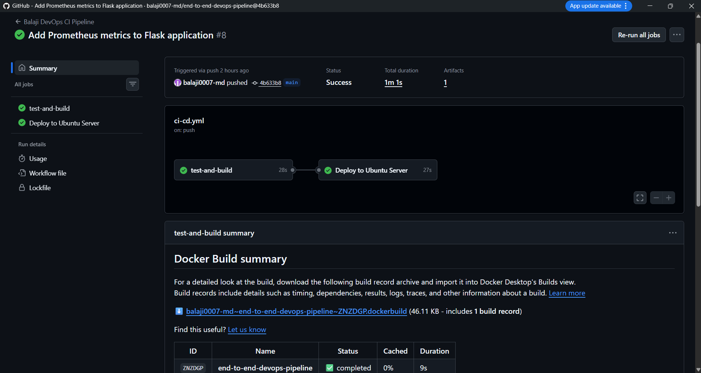
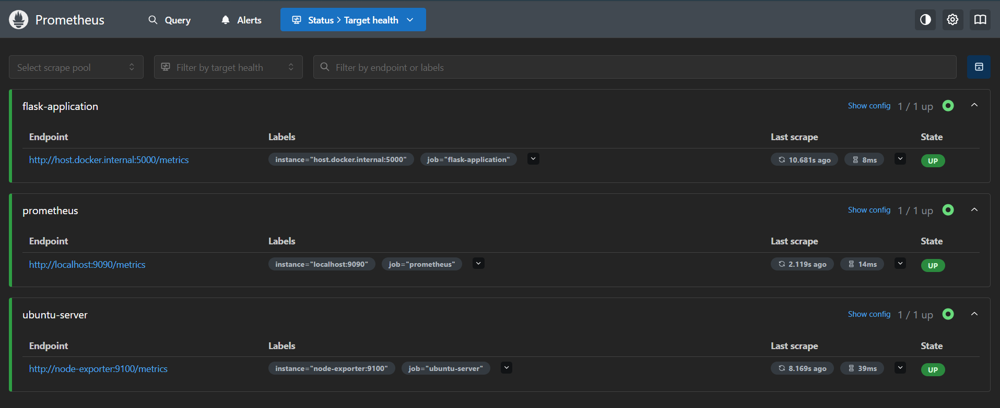
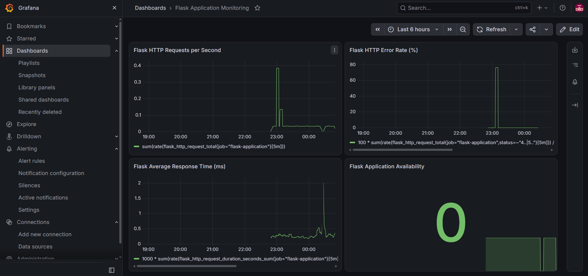
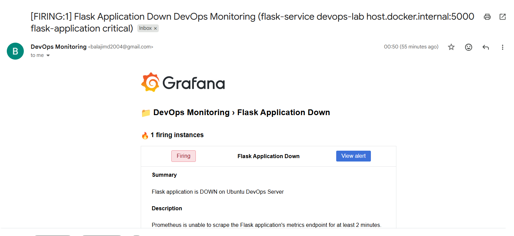

# End-to-End DevOps CI/CD Pipeline with Monitoring and Alerting

[](https://github.com/balaji0007-md/end-to-end-devops-pipeline/actions)


A hands-on DevOps project implementing automated testing, Docker image publishing, deployment to an Ubuntu virtual machine, application and server monitoring, and email notifications for downtime and recovery.

> **Environment:** A local Ubuntu VM hosted in VMware. This is a learning lab, not an internet-facing production or cloud deployment.

## Architecture

```text
Developer (Windows / VS Code)
            |
            v
     GitHub Repository
            |
            v
       GitHub Actions
       |           |
       |           +--> Unit tests
       |           +--> Docker build
       |           +--> Docker Hub push (latest + commit SHA)
       v
Self-hosted GitHub Actions runner (Ubuntu VM)
            |
            v
  Restricted deployment script
            |
            v
   Flask Docker container (:5000)
      |                 |
      +--> /health      +--> /metrics
                              |
                              v
                         Prometheus <--- Node Exporter (Ubuntu metrics)
                              |
                              v
                            Grafana
                              |
                    Dashboards + alert rule
                              |
                              v
                      Gmail SMTP notifications
```

## Technology Stack

| Technology | Purpose |
| --- | --- |
| Python, Flask | Web service and HTTP endpoints |
| `unittest` | Automated tests |
| Git, GitHub | Version control and source hosting |
| GitHub Actions | Continuous integration and deployment |
| Self-hosted GitHub Actions runner | Runs deployment on the Ubuntu VM |
| Docker, Docker Hub | Container runtime and image registry |
| Ubuntu Linux, VMware | Local deployment lab |
| Prometheus, Node Exporter | Application and host metrics |
| Grafana | Dashboards and availability alerts |
| Gmail SMTP | Email notifications |

## Application Endpoints

| Endpoint | Purpose |
| --- | --- |
| `/` | Application status |
| `/health` | Health-check endpoint |
| `/info` | Application and environment information |
| `/metrics` | Prometheus metrics |

## CI/CD Workflow

The workflow is defined in [`.github/workflows/ci-cd.yml`](.github/workflows/ci-cd.yml).

1. On configured GitHub events, GitHub Actions checks out the code, installs Python dependencies, and runs three unit tests.
2. Docker Buildx builds the container image.
3. For pushes to `main`, the workflow publishes `balajimd07/balaji-flask-service` to Docker Hub, tagged with `latest` and the Git commit SHA.
4. After CI succeeds, a deployment job runs on the Ubuntu self-hosted runner labeled `flask-deploy`.
5. The runner invokes a narrowly sudo-authorized deployment script (`/usr/local/sbin/deploy-flask`) that deploys the commit-SHA image and verifies the application's `/health` endpoint.

**Deployed container:** `balaji-flask-prod`  
**Application port:** `5000`  
**Docker Hub image:** `balajimd07/balaji-flask-service`

The deployment process replaces the running container, so it is **not zero-downtime**. A basic rollback path is intended to restore the previous image if the new deployment fails its health check; verify the current script and test results before describing rollback as fully implemented or guaranteed.

### Successful CI/CD Pipeline Execution

The GitHub Actions workflow successfully completes automated testing, Docker image building, and deployment to the Ubuntu server.



### Run the published image manually

```bash
docker pull balajimd07/balaji-flask-service:latest
docker run -d --name balaji-flask-service -p 5000:5000 \
  balajimd07/balaji-flask-service:latest
curl http://localhost:5000/health
```

## Monitoring

The Ubuntu VM hosts a Docker Compose monitoring stack in `/opt/devops-monitoring/compose.yaml` (server-local configuration).

### Prometheus targets

| Job | Target from Prometheus | Purpose |
| --- | --- | --- |
| `prometheus` | `localhost:9090` | Prometheus health and metrics |
| `ubuntu-server` | `node-exporter:9100` | Ubuntu host metrics |
| `flask-application` | `host.docker.internal:5000` | Flask HTTP metrics |

All three targets were verified as **UP** in the local lab. Prometheus is accessible on port `9090` of the Ubuntu VM.

### Prometheus Monitoring Targets

Prometheus successfully monitors the Flask application, Ubuntu server, and Prometheus itself. All three targets were verified as UP.



### Grafana dashboards

Grafana is accessible on port `3000` of the Ubuntu VM. Configured dashboards include:

- **Node Exporter Full:** CPU, memory, filesystem, network, and other host metrics.
- **Flask Application Monitoring:** HTTP request rate, HTTP error rate, average response time, and application availability.

Example PromQL queries:

**Requests per second**

```promql
sum(rate(flask_http_request_total{job="flask-application"}[5m]))
```

**HTTP error percentage**

```promql
100 *
sum(rate(flask_http_request_total{job="flask-application",status=~"4..|5.."}[5m]))
/
clamp_min(sum(rate(flask_http_request_total{job="flask-application"}[5m])), 0.000001)
```

**Application availability**

```promql
up{job="flask-application"}
```

### Flask Application Monitoring Dashboard

The custom Grafana dashboard displays HTTP request rate, HTTP error rate, average response time, and application availability.



## Alerting and Incident Simulation

A Grafana alert rule, **Flask Application Down**, monitors `up{job="flask-application"}`. It is configured to fire when the value remains **below 1** for a **2-minute pending period**, with evaluation every **1 minute**. Notifications are sent through Gmail SMTP.

A controlled downtime and recovery test verified the following sequence:

1. Stop the Flask container.
2. Prometheus marks the application target down.
3. Grafana fires the availability alert and delivers an email.
4. Restart the Flask container.
5. Prometheus detects recovery; Grafana resolves the alert and delivers a recovery email.

The alert summary uses neutral wording so both **Firing** and **Resolved** notifications remain accurate.

### Grafana Application Downtime Alert

Grafana detects Flask application downtime using Prometheus metrics and sends an email notification when the alert enters the FIRING state.

The following screenshot shows the alert notification received during a controlled application downtime test.



## Run Locally

```bash
git clone https://github.com/balaji0007-md/end-to-end-devops-pipeline.git
cd end-to-end-devops-pipeline
python -m pip install -r app/requirements.txt
python -m unittest discover -s tests -v
python app/app.py
```

Open `http://localhost:5000/` or check `http://localhost:5000/health`.

## Testing

The three Python unit tests cover the `/`, `/health`, and `/info` endpoints. They have been run successfully locally and as part of the GitHub Actions pipeline.

```bash
python -m unittest discover -s tests -v
```

## Troubleshooting (Ubuntu VM)

**Application container and logs**

```bash
sudo docker ps -a
sudo docker logs --tail 50 balaji-flask-prod
curl http://localhost:5000/health
```

**Monitoring containers**

```bash
cd /opt/devops-monitoring
sudo docker compose ps
sudo docker logs --tail 50 devops-grafana
```

**Prometheus scrape health:** open `http://<ubuntu-vm-ip>:9090/targets` from a machine that can reach the VM.  
**Pipeline failures:** review the failed job and step in the repository's [Actions tab](https://github.com/balaji0007-md/end-to-end-devops-pipeline/actions).

## Security and Scope

- Docker Hub credentials are managed using GitHub Actions secrets.
- The self-hosted runner uses a dedicated Linux account with narrowly scoped sudo permission for the deployment script.
- Commit-SHA tags make deployed image versions identifiable.
- Grafana SMTP credentials are stored in a **server-local** environment file, not in Git.
- Never commit `.env` files, `grafana-smtp.env`, SMTP app passwords, or other credentials.
- The local lab does **not** implement Kubernetes, Terraform, AWS hosting, high availability, or zero-downtime releases.

**Repository vs. server configuration:** The application, Dockerfile, tests, and GitHub Actions workflow live in this repository. The deployment script, monitoring Compose configuration, Prometheus configuration, and Grafana SMTP settings are maintained locally on the Ubuntu VM unless separately added to source control in a sanitized form.

## Future Improvements

- Version-control sanitized monitoring and deployment configuration
- Add screenshots of GitHub Actions, Prometheus targets, Grafana dashboards, and alert notifications (with private details redacted)
- Add Kubernetes deployment and infrastructure as code
- Explore deployment strategies with reduced downtime and automated recovery

## Author

**balaji0007-md** · [GitHub](https://github.com/balaji0007-md)
